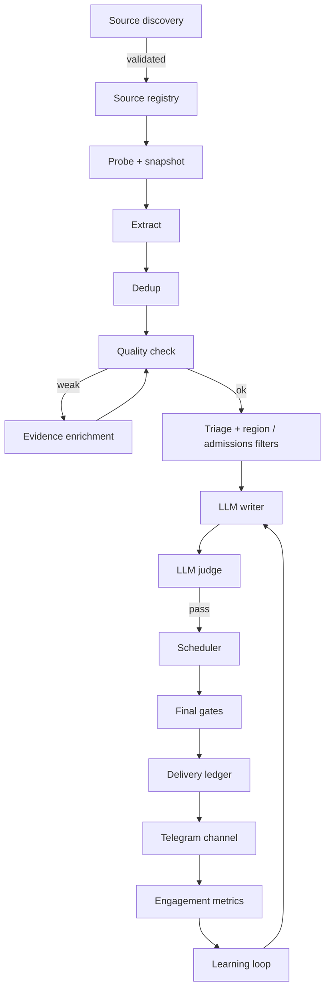
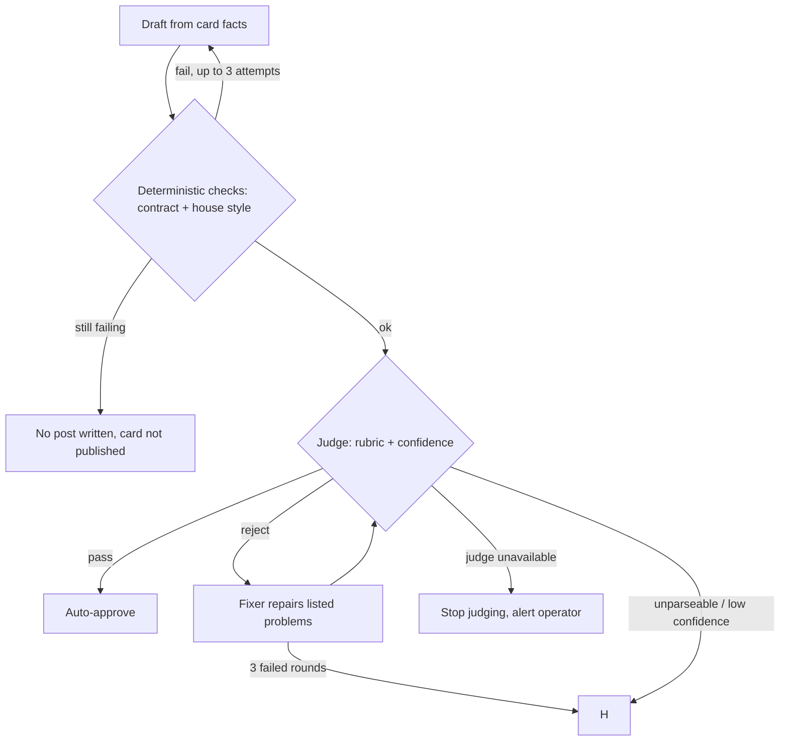

# GrantPulse

An editorial pipeline that finds scholarships, grants and internships for young people and publishes checked, source-backed posts to a Telegram channel.

**since Jun 2026, active · Python · SQLite · code: private**
## The problem

There are thousands of opportunities for students — fully funded master's programmes, UN internships, summer schools, fellowships, competitions — and they are scattered across university sites, international organisations and government portals. Russian-speaking students in the CIS and Central Asia mostly learn about them from Telegram channels. Those channels often repost each other, drop the official link, get deadlines wrong, or promise "fully funded" without proof.

A useful channel has to publish several posts every day, and each post has to be true. Doing that by hand does not scale. Doing it with a naive scraper plus a language model produces confident nonsense.

## What it does

- Monitors a curated registry of 150 official and aggregator sources, 147 of them monitored automatically. Most are universities, official scholarship programmes, international organisations and government portals; each has a priority and a reliability rating. A discovery step proposes new sources, which are validated or quarantined before they reach the registry, and sources that stay dead or yield mostly rejects are retired with a retry later.
- Turns raw pages into structured opportunity records: title, official URL, deadline, country, level, funding, eligibility and summary. It removes duplicates across sources.
- Scores every candidate. A triage pass drops navigation pages and junk, and deterministic rules reject programmes closed to the channel's region and plain admissions pages with no funding. Weak candidates go to enrichment, which reads the official page and fills in missing facts, but only with a verbatim quote as evidence. Deadlines are re-checked against the official page, and a conflict goes to a human instead of overwriting the stored date.
- Writes each post in Russian, in a fixed house style, using only facts it holds for that record. Deterministic style checks reject machine-sounding posts. An independent reviewer model then checks the post against a rubric before anything is approved.
- Schedules posts at human-looking times, at most one post per source site per day, deletes its own mistakes within tight limits, and collects views and reactions so later posts improve.
- Gives the operator two control surfaces: a local web console for reviewing cards, and a private Telegram bot with approve, redraft and publish buttons, cycle summaries and status.

## How it works

One unattended cycle owns the whole run, in a fixed stage order, under a database lock so overlapping cycles skip safely. Every stage writes its evidence to SQLite: raw items with content hashes, field-level evidence snippets, quality labels, review actions, publication attempts and delivery records. Any decision can be traced back to the page it came from.

## Engineering notes

- **Snapshots for auditability.** Every fetched page is stored on disk under a content-hash name and linked from its database row. A listing that later disappears or changes can still be checked against what the system actually saw.
- **Three LLM backends behind one interface.** A single client talks to a headless Gemini CLI agent (the default), a headless Claude Code CLI, or the official Anthropic SDK, chosen automatically. All of them enforce JSON schemas for verdicts, so no model output is parsed with regexes. Every call is logged with its duration and cost, and when the model quota runs low the cycle skips optional web work but keeps judging and scheduling.
- **The judge is stronger than the writer, and fails closed.** A different, larger model reviews each post and needs a confidence of at least 80. Output it cannot parse counts as a rejection. If rejections spike, a circuit breaker pauses auto-approval and alerts the operator.
- **An outage that looked like quiet.** Publishing once stopped for weeks: the judge's backend had lost access, transport failures were retried silently, and the summary just reported zero passes. Now the cycle stops judging at the first transport failure and the operator summary leads with "judge unavailable" and the cause. The same investigation fixed an ingestion error that aborted runs, made an offline machine stop a scan instead of marking healthy sources as broken, and handed posts that were blocked at scheduling to a human instead of retrying them every cycle.
- **Data-quality fixes found in production.** Some records had the official URL stored as their title and summary. They now fall back to the page's meta title or a readable URL slug, and the writer names the organisation from the official link's domain instead of presenting a generic page title as a programme name. Programmes open only to other regions kept passing the judge, so they are now rejected by a deterministic rule before drafting. A writer that listed unknown fields as "not specified" lines is blocked at the final send gate, not only at approval.
- **Posts that read like an editor, not a model.** After operator feedback that posts looked machine-written, the house style was rewritten (concrete benefit first, plain sentences, the deadline spelled out, a bare link) and backed by deterministic checks for a list of stock phrases, machine-formatted dates, countdowns and emoji or dash overuse. Those checks failed every one of the 30 most recent published posts, which is what justified the change.
- **Defence in depth on publishing.** Publishing requires two approved states: one for the candidate and one for the post. The checks run again at scheduling and again at send time, including a deadline-expiry check in case a deadline passes while the post sits in the queue.
- **Exactly-once delivery without help from Telegram.** The Bot API has no idempotency key, so each send first claims a local delivery record. A failure before any connection existed is retried; a reset or timeout mid-request might have delivered the post, so it is quarantined for reconciliation rather than resent, and the candidate is not re-queued while its delivery is unresolved.
- **One brain, many processes.** A database heartbeat and an explicit dispatch owner stop two machines, or two components, from publishing the same queue. A test that races two threads proves only one of them can claim a due post.
- **Found by audit and lint, not by luck.** An adversarial review uncovered approved posts being silently stranded by duplicate draft rows. Enabling a linter exposed an enrichment step that had been failing silently for a week. Both now have regression tests.
- **It maintains itself, with a human gate.** A nightly agent may propose one small patch in a disposable worktree; the harness runs lint, tests and the replay itself and keeps the patch on a review branch only if all pass, and never merges it. Scheduled daily and weekly agent runs fix health problems first, ship one tested change through a pull request, and keep a growth log of hypotheses judged against subscriber and view metrics. Anything outside the pipeline, such as outreach or channel settings, goes to the operator as a yes/no proposal.

## How it is verified

- 47 offline test modules with 320 test functions. The tests use temporary SQLite databases, swap in stub LLM calls and stub network calls, so they need no network access.
- Lint (ruff) and tests run in CI on every pull request and every push to the main branch, and locally as a single `make check`.
- A deterministic seven-day replay runs the production quality policy and approval and publication validators on fixture feeds with no database, network, LLM or Telegram access. It must produce exactly four publishable candidates per day (28 over the week), add zero new work when the same week is replayed, and block a high-scoring invalid candidate even when both approval states are forced on.
- Changes to LLM behaviour were tested live against real candidates before they shipped. For example, three models were compared on the same guardrails before a default was chosen, enrichment runs were checked for invented facts, and the new house style was run on 6 real candidates: all passed the style checks, and the judge rejected 3 that were not real opportunities.
- Destructive actions (publishing, deleting) are dry-run by default and audited. Before any deletion a local backup is written, and there is a cap of 3 deletions per run. Posts are deleted only for substantive failures, never for style alone.

## Stack

Python 3.10+, SQLite (WAL mode, versioned migrations), Telegram Bot API, Telethon (engagement metrics), a headless Gemini CLI agent, the Claude Code CLI and the Anthropic Python SDK, Pillow, pytest, ruff, GitHub Actions. It runs on macOS under launchd, and a systemd unit is included for a Linux VPS.

## Access

The code is private. To request a walkthrough or read access, open an issue in this repository or email eazamat360@gmail.com.
